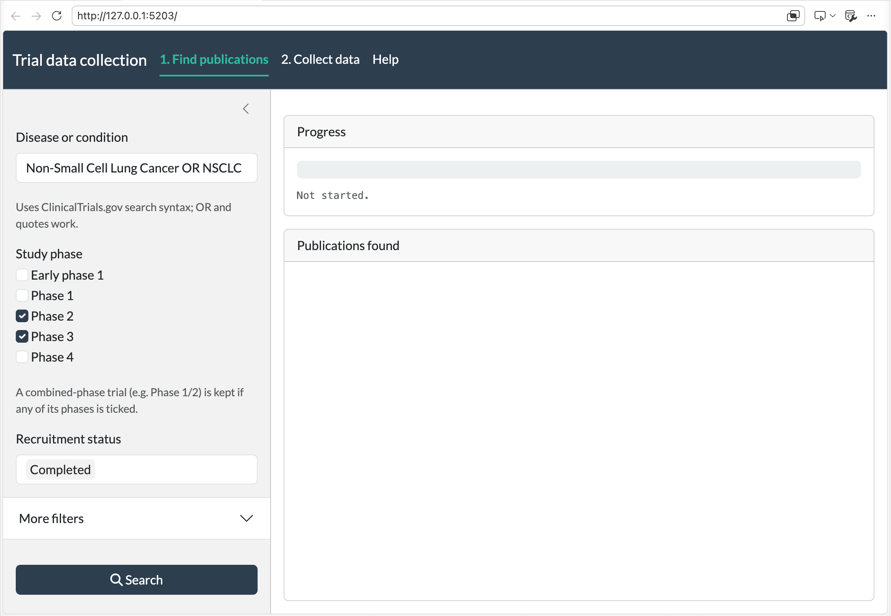
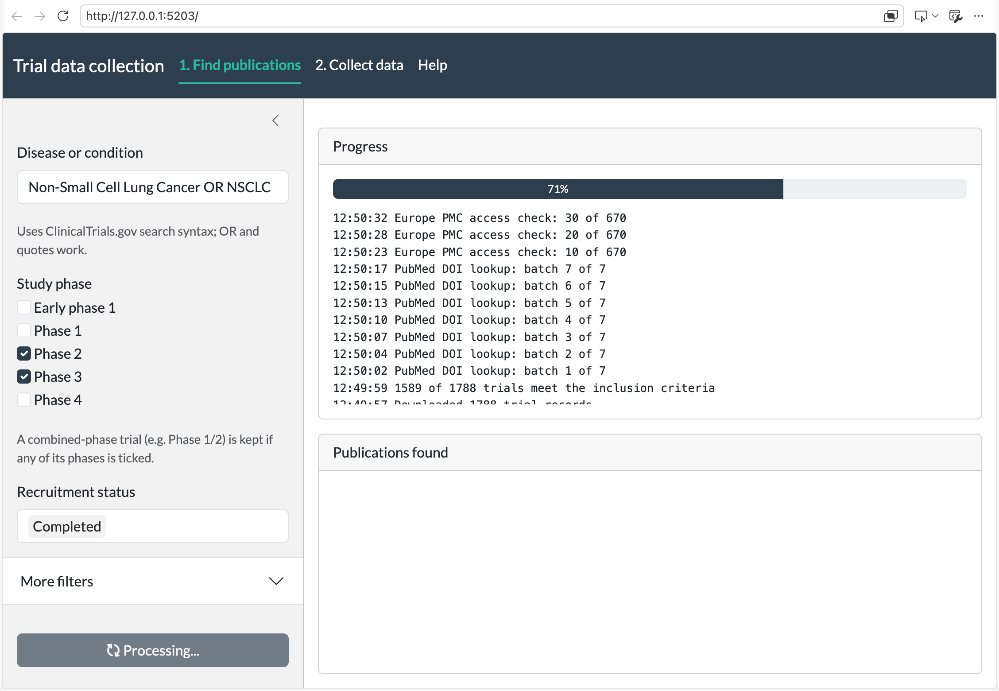
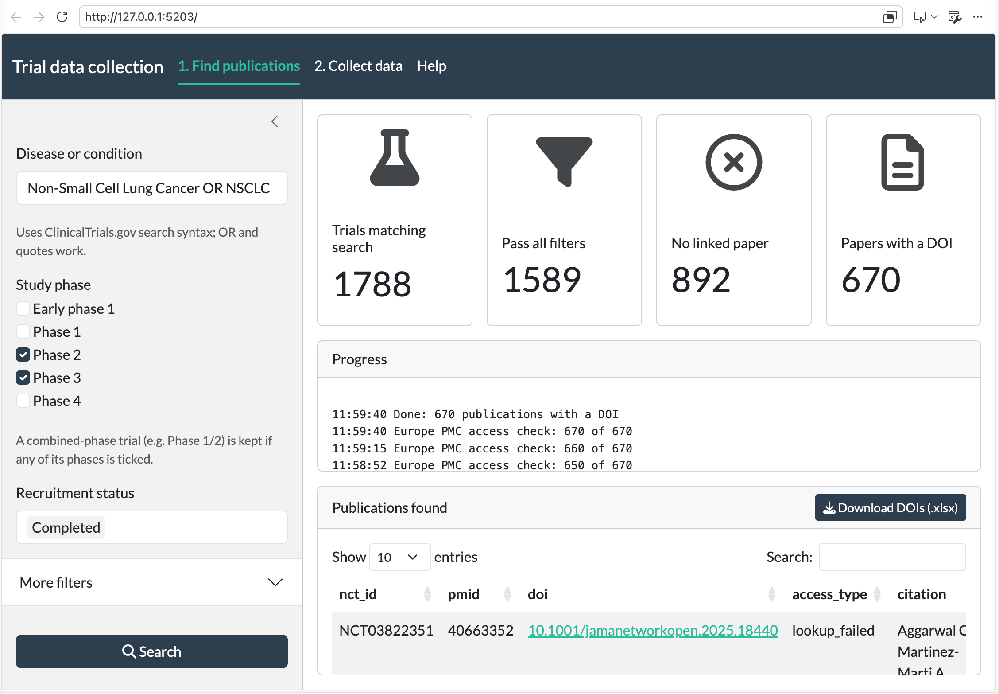
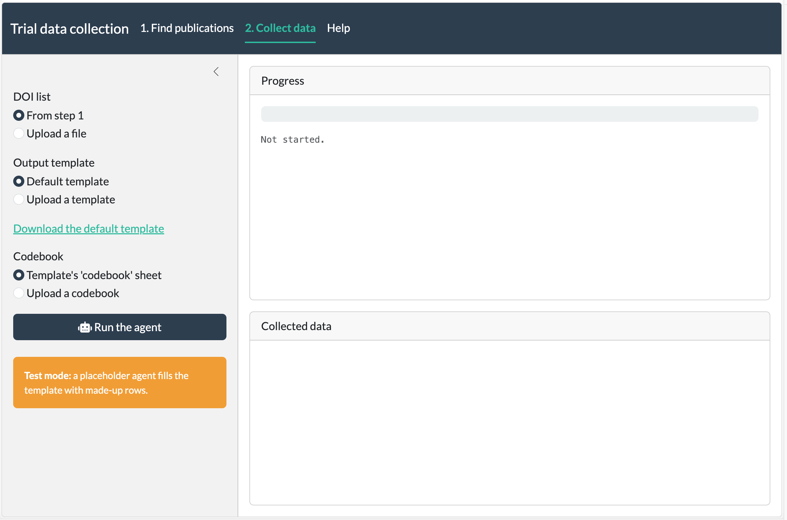

# Trial data collection app (R Shiny)

A two-step web app for colleagues:

1. **Find publications.** Enter a disease, phase(s) and status. The app searches ClinicalTrials.gov, links each trial to its results paper by PubMed ID, looks the papers up in Europe PMC (DOI, PubMed Central ID, open access), and returns the paper list as Excel.
2. **Collect data.** Give it the paper list, an empty output template and a codebook. The data-collection agent reads each paper and fills the template, which the user downloads.

The agent is currently a **placeholder** (test mode) that returns made-up rows, so the whole app can be tried before a real agent exists.

## Demo

**Step 1, before searching.** The app opens on this tab. Enter the disease or condition, tick the study phases and choose the recruitment status on the left. **More filters** holds the intervention type, primary purpose and enrollment options. Then click **Search**.



**Step 1, searching.** The Progress card shows the progress bar and each stage as it runs (ClinicalTrials.gov search, linking trials to papers, Europe PMC lookup), newest first.



**Step 1, results.** The summary boxes give the trials found (after all filters), the papers linked to them, and the open-access papers. The table lists the papers, and **Download papers (.xlsx)** saves them for review. The filter above the table chooses between open-access papers, which the AI agent can read through their PubMed Central ID (the default), and all linked papers. The same list goes to step 2; the Excel file also has every linked paper in a separate sheet.



**Step 2, collecting data.** Choose the paper list (from step 1 or an uploaded file with a `pmid`, `doi` or `pmcid` column), the output template, the codebook and the rules (the default NSCLC rules, or your own .txt/.md file; **Download the default rules** shows what the agent gets), then click **Test the agent on 10 papers** to check the agent on the first 10 papers, or **Run the agent** for all of them. Only open-access papers (each has a PubMed Central ID) are sent to the agent; papers in an uploaded list with no `access_type` are checked in Europe PMC first. The orange box means the app is in test mode with the placeholder agent.



## Files

| File | What it does |
|---|---|
| `app.R` | Page layout and app logic |
| `R/search_trials.R` | Step 1: ClinicalTrials.gov search and filters (same rules as `scripts/data_collection_scripts/01_*.R`), linking each trial to its first results paper with a PubMed ID, and the Europe PMC lookup |
| `R/agent.R` | Step 2: reads the template and codebook, sends papers to the agent in batches of 10 per message, writes the results into the template |
| `python/copilot_agent.py`, `requirements.txt` | Connection to the Copilot Studio agent through Microsoft's Python SDK |
| `R/utils.R` | Progress reporting for long runs |
| `defaults/` | Default template, plus the collection and exclusion rules sent to the agent with each batch |
| `manifest.json` | Package list Posit Connect needs to install the app |
| `screenshots/` | Pictures of the app used in this README (not used by the app) |

## Run it on your computer

In R, from the project root:

```r
shiny::runApp("app")
```

**To stop the app**, click in the terminal where it's running and press **Ctrl + C** (also Ctrl on a Mac, not Cmd). The app is stopped when the R prompt `>` returns. Closing the browser tab doesn't stop it.

## Publish on Posit Connect from GitHub

1. Push the repo to GitHub, including `app/manifest.json`.
2. In Posit Connect: **Publish → Import from Git**. Enter the repo URL and branch `main`, and pick the `app` folder.
3. Connect installs the packages listed in `manifest.json` and starts the app. It re-deploys automatically when you push to the branch, if you turn that on.
4. Under **Access**, choose who can open the app.

**Update `manifest.json` when you add an R or Python package or upgrade R:**

```r
rsconnect::writeManifest(appDir = "app", appPrimaryDoc = "app.R", python = "app/.venv/bin/python")
```

The manifest records R 4.3.3. If Connect doesn't have that version, it uses the nearest one it has; ask your Connect admin if deployment fails on the R version.

## Settings (environment variables)

Set these in Posit Connect under **Settings → Advanced → Environment Variables**, or in `~/.Renviron` locally. Never put keys in the code.

| Variable | Needed? | Meaning |
|---|---|---|
| `AGENT_BACKEND` | no | `mock` (default, placeholder agent), `copilot` (Copilot Studio agent) or `http` (other hosted agent) |
| `COPILOT_CONNECTION_STRING` | with `copilot` | The connection string from Copilot Studio → Channels → App → Microsoft 365 Agents SDK |
| `COPILOT_TENANT_ID`, `COPILOT_CLIENT_ID` | with `copilot`, on your computer only | Entra ID tenant and app registration, for signing in through the browser |
| `COPILOT_TIMEOUT_SECONDS` | no | Time allowed per paper in a message (default 300 s; at least 15 min per message) |
| `AGENT_URL`, `AGENT_API_KEY` | with `http` | Web address and key of another hosted agent |

## Copilot Studio agent

The app talks to the agent with Microsoft's Python SDK (`python/copilot_agent.py`), called from R through `reticulate`. Papers are sent in batches of 10, each batch in a new conversation, and the agent replies with JSON rows that the app writes into the template. The agent runs under the signed-in colleague's Microsoft account.

**One-time setup (needs IT / admins):**

1. **Entra ID app registration** with the delegated API permission **`CopilotStudio.Copilots.Invoke`** (under Power Platform API), admin-consented.
   - For testing on your computer: add the platform "Mobile and desktop applications" with redirect URI `http://localhost`.
   - For Posit Connect: add a client secret and Connect's OAuth redirect URI (your Connect admin provides it).
2. **Posit Connect OAuth integration** for Microsoft Entra ID using that app registration, with scope `https://api.powerplatform.com/.default` (plus `offline_access`). Then attach the integration to this app (app settings → Access → Integrations).
3. **Publish the agent** in Copilot Studio and share it with the colleagues who will use the app.

**Agent setup:** follow `build_agent/agent_setup.txt`. In short, paste `build_agent/copilot_instructions.md` as the agent's instructions, upload no knowledge files, and give the agent a tool that can open web pages. The instructions are general: each message from the app (see `copilot_message()` in `R/agent.R`) carries the papers, the template's columns, the codebook and the disease rules from `app/defaults/collection_rules.txt` and `exclusion_rules.txt`. Users can replace them for a run by uploading their own rules in step 2; to change the defaults, edit those files. The agent doesn't need to change. The app numbers `arm_id` itself, and possible overlaps between trials are flagged in `notes` ("POSSIBLE OVERLAP:") for review.

**Test on your computer first:**

```bash
cd app
python3.11 -m venv .venv
.venv/bin/pip install -r requirements.txt
```

Then put `AGENT_BACKEND=copilot`, `COPILOT_CONNECTION_STRING`, `COPILOT_TENANT_ID` and `COPILOT_CLIENT_ID` in `~/.Renviron`, restart R, and run the app. The first run opens a Microsoft sign-in page. Click **Test the agent on 10 papers** first and check the results against the papers before a full run.

**On Posit Connect:** Connect builds the Python environment from `requirements.txt` (the version is recorded in `manifest.json`). Set `AGENT_BACKEND=copilot` and `COPILOT_CONNECTION_STRING` under **Settings → Advanced → Environment Variables**. Connect must have Python 3.10 or later.

**Token lifetime:** the sign-in token is taken when the run starts and usually lasts about an hour. For long runs, split the paper list into batches.

## Plugging in another agent

The app only calls the agent through `agent_process_batch()` in `R/agent.R`. The Copilot Studio agent gets each batch in one message; the mock and `http` agents are called once per paper. The agent receives the paper (`nct_id`, `pmid`, `pmcid`, `doi`, `access_type`, `citation`), the template's column names per sheet, the codebook text, and the rules (from `defaults/`, or the file uploaded in step 2). It returns rows per sheet, for example:

```json
{"included_arms": [{"arm_label": "Arm A", "arm_sample_size": 120}],
 "excluded": [],
 "failed_papers": []}
```

- **An agent with a simple web API:** make it accept and return that JSON (the contract is at the top of `agent_http()`), then set `AGENT_BACKEND=http`, `AGENT_URL` and `AGENT_API_KEY`.
- **Any other agent** (e.g. Copilot Studio through Direct Line, or a model API): write a new `agent_<name>()` function with the same arguments and return value as `agent_mock()`, and add it to the `switch()` in `agent_process_batch()`.

The rest of the app doesn't change.

## Notes

- The rules the app sends to the agent are `defaults/collection_rules.txt` and `defaults/exclusion_rules.txt`. They're adapted from the first agent's instructions (`build_agent/version1/`) for batch processing; edit them here. The default template is `defaults/output_template.xlsx`.
- Long steps run in a background R process, so one user's run doesn't block others. The app keeps two background workers; raise `workers` in `app.R` if several people run it at once.
- A very broad search (e.g. just "cancer") shows a warning in the progress log if it matches more trials than the number under **More filters**; the search still runs.
