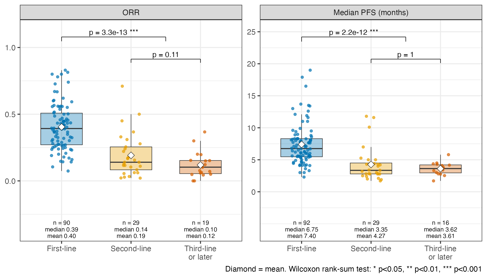

# Covariate Rationales

Why each covariate in the arm-level models ([statistical_methods.md](statistical_methods.md)) is
grouped into its current categories. Numbers refer to the current `claude_collected` sheet
(199 arms) and the Model 1 fitting set (84 arms after complete-case filtering).

## Line of therapy: first-line vs pretreated, plus a maintenance indicator

`participants_trt_status` is free text. It is coded into a binary `first_line` indicator
(1 = first-line, 0 = pretreated), with a separate `maintenance` indicator for maintenance arms.
Coding by `tabulate_MOA_TrtStatus.R`; values written to the sheet by `add_derived_variables.R`.

| Line | Arms | Median ORR | Median PFS (months) |
|---|---|---|---|
| First-line | 95 | 0.39 | 6.8 |
| Second-line | 31 | 0.14 | 3.4 |
| Third-line or later | 19 | 0.10 | 3.6 |
| Pretreated, number of lines unclear | 44 | 0.18 | 3.7 |
| Maintenance / mixed, coded first-line | 10 | 0.06 | 3.8 |

### Why not separate second-line and later-line categories

*Arms with a known line of therapy and a reported outcome (maintenance, mixed and
unclear-line arms not shown). Box = median and IQR, diamond = mean. Brackets: Wilcoxon
rank-sum test. Made by `scripts/stat_method/rationale_figures.R`.*

- **The pretreated lines don't differ from each other.** Second-line vs third-line-or-later:
  ORR 0.14 vs 0.10 (Wilcoxon rank-sum test p = 0.11), median PFS 3.4 vs 3.6 months (p = 1.0).
  Separate categories would add parameters without adding information.
- **Many pretreated arms can't be assigned to a specific line.** 44 arms report prior treatment
  without a clear number of lines, for example "second- or later-line", "previously treated
  (1–2 prior lines)", or mixed populations. A multi-level variable would force us to drop these
  arms (22% of the data) or guess their line. A binary variable classifies every arm.
- **There are too few arms per level in the model.** After complete-case filtering, Model 1
  would have only 10 second-line and 2 later-line arms. Separate coefficients would be unstable,
  and in a model already fitting 15–16 parameters on 84 arms that costs precision elsewhere.

### Coding rules

- Maintenance after first-line induction counts as first-line.
- Mixed populations count as first-line only if more than 50% of patients are treatment-naive.

### Maintenance indicator

Maintenance arms enrol patients who have not progressed after induction chemotherapy. Their
ORR is measured after the induction response has already shrunk the tumour, so it is low
(median 0.05 across the 9 maintenance arms) even though the patients are first-line.
Leaving them in the first-line group mixes two different response definitions.

`maintenance` = 1 for these arms (all of which also have `first_line` = 1). Its coefficient
is therefore the difference between maintenance and other first-line arms. Adding it to the
models:

| | Without `maintenance` | With `maintenance` |
|---|---|---|
| Model 1.3 first-line OR | 2.58 | 2.90 |
| Model 1.3 maintenance OR | – | 0.29 (p = 1e-4) |
| Model 1.2 maintenance OR | – | 0.34 (p = 5e-4) |
| Model 1.3 AIC | 659.6 | 645.4 |
| Pearson χ²/df (Model 1.1) | 8.5 | 7.5 |
| Model 2 (observed ORR) maintenance median-PFS ratio | – | 1.10 (p = 0.35) |

- **ORR:** maintenance arms have about 70% lower odds of response than other first-line arms,
  and separating them sharpens the first-line effect.
- **PFS:** no separate effect once ORR is in the model.
- **Fit:** the indicator improves AIC by 14 and removes part of the overdispersion.
